# Arquitectura — Agente pagador de facturas

Diagrama para el README (lo incrusta T5.5). Verde: implementado y con pruebas. Naranja: pendiente en el tablero. Fuente de los nombres: `backend/app/graph/build.py`, `backend/app/api/app.py`, `frontend/app/`.

```mermaid
flowchart LR
    subgraph Entrada["Entrada (datos no confiables)"]
        PDF[PDF / email / chat]
    end

    subgraph UI["Frontend Next.js (Vercel)"]
        Subir["/subir"]
        Reglas["/reglas"]
        Decisiones["/decisiones y /decisiones/[id]"]
        Aprob["/aprobaciones"]
        Metricas["/metricas"]
        Proxy["Proxy /api/* (inyecta X-Admin-Key en servidor)"]
    end

    subgraph API["API FastAPI (Render, un solo worker)"]
        Auth["Clave admin en PUT /rules, approve, reject (T5.9)"]
        Lock["Lock: decidir + persistir en serie (T5.8)"]
    end

    subgraph Grafo["Grafo LangGraph, fail-closed"]
        Ingest[ingest] --> Extract["extract (LLM, citas literales)"]
        Extract --> Contract["contract_lookup"]
        Contract --> JEV["jev_checks (señales, no decide)"]
        JEV --> Det["det_checks R01–R13 (puras)"]
        Det --> Agg["aggregate: decide() puro"]
        Agg --> Rec["record (plantillas, sin LLM)"]
        Rec --> Ver["verify (LLM, solo sube severidad)"]
        Ver --> Gate["final_gate (invariantes I1–I9)"]
        Ingest -. error .-> Tech[escalate_technical]
    end

    subgraph Datos["Persistencia y configuración"]
        DB[("Postgres: decisiones, ledger, eventos humanos")]
        Cfg["rules.json · company.json · fx.json · contratos"]
        Chain["Cadena de hashes del registro (T5.10)"]
    end

    Trazas["LangSmith (trazas por decisión)"]
    CI["CI: ruff, pytest, eval unsafe_pay=0, CodeQL (T6.4)"]

    PDF --> Subir --> Proxy --> API
    Reglas --> Proxy
    Aprob --> Proxy
    API --> Ingest
    Gate --> DB
    Cfg --> Det
    DB --> Decisiones
    DB --> Metricas
    Grafo -.-> Trazas
    DB -.-> Chain

    classDef done fill:#d1fae5,stroke:#059669,color:#064e3b;
    classDef todo fill:#ffedd5,stroke:#ea580c,color:#7c2d12;
    class Ingest,Extract,Contract,JEV,Det,Agg,Rec,Ver,Gate,Tech,Subir,Reglas,Decisiones,Aprob,Metricas,Proxy,Auth,Lock,DB,Cfg,Trazas done;
    class Chain,CI todo;
```

## Invariante central

Ningún modelo emite `PAGAR`. `PAGAR` sale solo si las 13 reglas deterministas dan OK (`backend/app/rules/decide.py`), el verificador no subió la severidad y `final_gate` vuelve a comprobar todo (`backend/app/gate/final_gate.py`). Cualquier error o dato faltante termina en `ESCALAR`.
